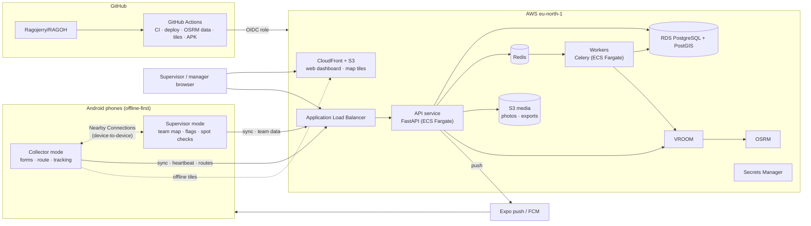
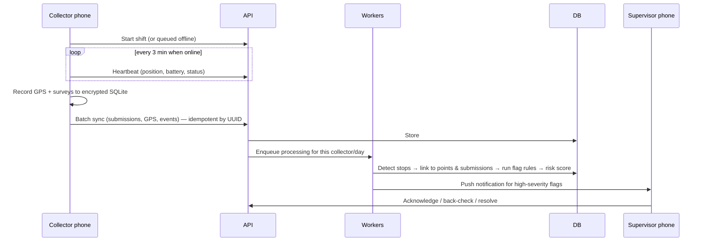

# RAGOH — Section 0: Architecture & Plan

Status: **proposal for review**. Nothing here is built yet. Reply "go" on the pull request to start Phase 1, or comment on any line to change it.

---

## 0. Answers from review (26 Nov 2026)

| Question | Answer | What it changes |
|---|---|---|
| First deployment size | **4 collectors, 2 supervisors** (pilot) | Pilot hosting mode (§3.3) instead of the full ECS stack — much cheaper. Code and schema stay the same, so scaling up later is a hosting change, not a rewrite. |
| Existing XLSForm | None | I'll write three seed forms: a household survey, a supervision checklist and a back-check form. |

| Phones | Android (models not specified) | Target Android 8+; Phase 3 field test on the pilot team's own phones. |
| Integrations | Yes, no preference on which | All three connectors (DHIS2, Elasticsearch/Kibana, DIGIT HCM) are designed as optional, switch-on-per-campaign services built after Phase 7 (§10a). Which ones to build first is decided then. |
| Pilot area | **FCT Abuja** | OSRM `foot` data built from the FCT area only (Nigeria extract clipped to the FCT boundary); offline map tiles for FCT's six area councils. |
| Hosting | **Pilot server** | Phase 1 builds §3.3 pilot mode. |

---

## 1. Assumptions

Where the spec left a value open, I've assumed the following. Each is easy to change later.

| Area | Assumption |
|---|---|
| Scale | Pilot: 4 collectors, 2 supervisors. Design target for later: up to 1,000 collectors, 50 supervisors, 200,000 visit points |
| Team size | A supervisor manages up to 30 collectors |
| Devices | Android 8+ (API 26+), 2–3 GB RAM, ≥ 2 GB free storage. No iOS in v1 |
| Offline period | Collectors can work fully offline for 7 days |
| Heartbeat | Every 3 minutes while on shift and online |
| GPS sampling | 10 s moving / 90 s stationary; points with accuracy worse than 50 m are kept but tagged as low-quality |
| Stop detection | R = 50 m, T = 3 min (configurable per campaign) |
| Geofences | Household 50 m, settlement 150 m, facility 100 m, school 100 m, other 75 m |
| Data retention | Raw GPS kept 90 days, then only stops and daily summaries |
| Languages | English in v1; text externalised for Hausa, Yoruba, Igbo and Pidgin |
| Forms | XLSForm (ODK/Kobo style) as the authoring format, with the common subset listed in §6.4 |
| Hosting | One AWS staging environment in eu-north-1 (Stockholm); production is added later once you upgrade from the AWS free plan |
| Domain | None yet; the pilot uses a free `*.sslip.io` hostname with an automatic HTTPS certificate |
| Integrations | DHIS2, Elasticsearch/Kibana and KoboToolbox: designed for (clean export APIs), not built in v1 |

---

## 2. Key technology decisions

### 2.1 Mobile: React Native + Expo (not Flutter)
- **Why:** one language (TypeScript) across mobile, web dashboard and shared packages (form engine, validation, types); **Expo EAS Build** produces APKs in the cloud, which fits the no-local-machine workflow; over-the-air updates let us fix bugs without reinstalling on hundreds of phones.
- **Background location:** `expo-location` + `expo-task-manager` running as an Android **foreground service** with a persistent notification, plus Android activity recognition for adaptive sampling. A small custom Expo native module handles what Expo doesn't: mock-location flag per point, boot-restart during an active shift, and battery-optimisation exemption prompts.
- **Fallback if field tests show unreliable tracking on low-end phones:** switch the tracking layer to the commercial `react-native-background-geolocation` library (paid licence for release builds). The tracking code sits behind an interface so this swap touches one module.
- **Local database:** `expo-sqlite` with **SQLCipher** encryption, accessed through Drizzle ORM. An outbox table drives sync.
- **Maps:** MapLibre React Native with offline **PMTiles** per LGA.
- **Device-to-device sync (Phase 6):** custom Expo module wrapping Android **Nearby Connections** (Wi-Fi Direct/Bluetooth). QR-chunk transfer as last resort. This is the highest technical risk in the project and is isolated in its own phase.

### 2.2 Backend: Python FastAPI + PostgreSQL/PostGIS
- FastAPI, SQLAlchemy 2 + GeoAlchemy2, Alembic migrations, Pydantic v2.
- **Celery + Redis** for background jobs: stop detection after GPS sync, flag rules, daily summaries, route optimisation, retention clean-up.
- Algorithms (stop detection, risk score) in plain Python + NumPy so they are easy to unit-test.

### 2.3 Routing: OSRM + VROOM
- OSRM with a Nigeria OpenStreetMap extract, profiles: `foot`, `motorcycle` (adapted car profile with lower speeds and access to tracks), `car`.
- VROOM for multi-stop day plans (calls OSRM for the distance matrix).
- Routing data is prepared by a GitHub Actions job and stored in S3; containers load it at start-up.
- **Cost note:** each OSRM profile for Nigeria needs roughly 2–4 GB RAM. Staging starts with **one profile (`foot`)**; others are switched on by config.

### 2.4 Web dashboard: React + TypeScript + Vite
- MapLibre GL JS, TanStack Query and TanStack Table, ECharts for charts.
- Served as static files from S3 + CloudFront.

### 2.5 Notifications and auth
- Push: **Expo push service** (uses Firebase Cloud Messaging underneath; FCM credentials stored in AWS Secrets Manager).
- Auth: JWT access token (15 min) + refresh token (30 days, rotated). Offline login uses the last successful session plus a 4–6 digit **PIN** checked against a salted hash stored on the device. Remote revoke and wipe via a device-blocked flag checked at every sync.
- Authorisation: role + **geographic scope** enforced in the API on every query (a supervisor only ever receives rows for their teams).

---

## 3. System architecture



### 3.1 Data flow: a collector's day


### 3.2 AWS staging layout (cost-conscious)
- **VPC** with public and private subnets in 2 AZs (the load balancer needs two); **no NAT gateway** in staging (saves ~USD 35/month): Fargate tasks get outbound access through VPC endpoints for ECR, S3, Secrets Manager and CloudWatch Logs.
- **ECS Fargate** services: `api` (0.5 vCPU / 1 GB), `worker` (0.5 vCPU / 1 GB), `redis` (0.25 vCPU / 0.5 GB — instead of ElastiCache, staging only), `osrm-foot` (1 vCPU / 4 GB), `vroom` (0.25 vCPU / 0.5 GB).
- **RDS PostgreSQL 16** `db.t4g.micro`, 20 GB gp3, single-AZ, 7-day backups, encrypted.
- **S3**: `ragoh-staging-media`, `ragoh-staging-web`, `ragoh-staging-tiles`, `ragoh-routing-data`.
- **Rough staging cost: USD 70–95/month** when everything runs 24/7 (load balancer ~18, Fargate ~45, RDS ~15, endpoints/other ~10). To stay under the USD 100 budget, the deploy workflow can **scale staging to zero outside working hours** (one switch).
- Production (later): Multi-AZ RDS, ElastiCache, NAT or more endpoints, autoscaling, WAF, own domain + ACM certificate.

### 3.3 Pilot hosting mode (recommended for the 4 + 2 pilot)
The full layout in §3.2 is sized for hundreds of users. For the pilot, one small server runs the same containers:

- **One EC2 instance** `t4g.medium` (2 vCPU, 4 GB RAM, ARM) in a public subnet, running `docker compose`: `api`, `worker`, `redis`, `osrm-foot`, `vroom`, and **Caddy** as the web server with automatic HTTPS (free Let's Encrypt certificate on a free `*.sslip.io` hostname until you have a domain).
- **RDS PostgreSQL** `db.t4g.micro` (backups, encryption) — or PostgreSQL in a container on the same server to save ~USD 15/month, with nightly backups to S3.
- **S3 + CloudFront** for the web dashboard, photos and map tiles (pennies at this scale).
- **OSRM data for the pilot state only** (not all of Nigeria), so it fits comfortably in memory.
- Deploys still go through GitHub Actions + OIDC: images are pushed to ECR and the server is updated via **AWS Systems Manager** (no SSH keys).
- **Estimated cost: USD 20–40/month** (EC2 ~25 or less with a savings plan, RDS ~15 or 0 if containerised, rest ~2).
- **Moving to full mode later** = switching Terraform from the `pilot` module to the `ecs` modules; the containers and database are the same.

---

## 4. Sync design

| Direction | What | Rule |
|---|---|---|
| Phone → server | submissions, media, GPS batches, shift events, stop-status changes, flag replies, supervisor actions | Each record has a client UUID; the server upserts by UUID, so retries never duplicate. Batches of ≤ 500 GPS points, gzip. |
| Server → phone | assignments, visit points, forms, config, team data (supervisors), messages | Pull by cursor (`updated_since`, per table). Server wins. |
| Conflicts | e.g. a point reassigned while the collector completed it offline | Completed submission is kept; reassignment is cancelled for that point; both logged in `sync_conflicts` and shown to the supervisor. |
| Media | photos | Uploaded after the form data via presigned S3 URLs, resumable, compressed to ≤ 1600 px / ~300 KB. |
| Device-to-device | supervisor pulls collector's unsynced outbox | Same payload format as server sync, signed and encrypted with a per-session key from a QR handshake; the supervisor's phone forwards it and the server de-duplicates by UUID. |

Time: every record stores `device_time`, `device_tz`, `server_received_at`. A server-time offset is measured at each sync to detect clock tampering (rule R13).

---

## 5. Core algorithms

### 5.1 Stop detection (stay-point)
1. Drop points flagged as mock; keep low-accuracy points but weight them less.
2. Smooth with a 3-point median filter to reduce jitter.
3. Walk the track: start a candidate at point *i*; extend while points stay within **R** of the running centroid; a candidate lasting ≥ **T** becomes a stop.
4. Merge stops separated by < 2 min and < R (handles GPS dropouts inside a house).
5. Gaps > G minutes during a shift become `tracking_gap` events, not stops.
6. Link each stop to the nearest visit point (PostGIS `ST_DWithin` with that point's geofence) and to submissions whose time and GPS fall inside it.
7. Classify: `at_assigned_point`, `near_assigned_point` (≤ 2× geofence), `unassigned_location`, `base` (≥ 3 long stops at the same place across days).

Tests use synthetic tracks from the GPS simulator: jitter ±15 m, 5-minute dropouts, slow walking (< 1 m/s), and a collector who completes surveys while moving.

### 5.2 Route suggestion
- Online: `GET /routes/to?point=` → OSRM route; `POST /routes/day-plan` → VROOM job with priorities and time windows → ordered stops + geometry, cached on the phone.
- Offline: nearest-neighbour + 2-opt over haversine distances on the phone, labelled "estimated – offline"; straight-line bearing guidance where roads are missing.

### 5.3 Flags and risk score
- Each rule (R1–R15 from the spec, plus S1 "collector not visited by supervisor in N days" and S2 "high-risk collector with no follow-up within H hours") is a small Python class: `id`, `severity`, `params`, `evaluate(collector_day) -> list[Flag]`.
- Rules run after each processed sync and nightly; flags are de-duplicated by (rule, subject, day).
- **Risk score** per collector-day = Σ (severity weight × count), with weights low = 1, medium = 3, high = 8, capped at 100. The dashboard always shows the flags behind a score.

---

## 6. Database schema

All IDs are UUIDs (generated on the device for anything created offline). All tables have `created_at`, `updated_at`; soft deletes via `deleted_at` where users can delete. Geometry is SRID 4326 with GIST indexes.

### 6.1 Organisation and people
| Table | Key columns |
|---|---|
| `organisations` | id, name |
| `campaigns` | id, organisation_id, name, type (survey/SMC/ITN/RI/other), start_date, end_date, work_start_time, work_end_time, timezone, config (jsonb: thresholds, geofences, sampling) |
| `admin_areas` | id, parent_id, level (state/lga/ward/settlement), name, code, geom (MultiPolygon) |
| `users` | id, organisation_id, full_name, phone, email, password_hash, pin_hash, role (collector/supervisor/manager/admin), status, language |
| `user_area_access` | user_id, admin_area_id |
| `teams` | id, campaign_id, name, admin_area_id |
| `team_members` | team_id, user_id, role_in_team (collector/supervisor), active_from, active_to |
| `supervisor_team_assignments` | supervisor_id, team_id, active_from, active_to |
| `devices` | id, user_id, model, android_version, app_version, push_token, is_blocked, last_seen_at, last_battery |
| `consents` | id, user_id, notice_version, accepted_at |

### 6.2 Work and movement
| Table | Key columns |
|---|---|
| `visit_points` | id, campaign_id, external_id, name, type, admin_area_id, geom (Point), geofence_m, priority, window_start, window_end, attributes (jsonb) |
| `assignments` | id, visit_point_id, collector_id, planned_date, status (pending/en_route/arrived/in_progress/completed/not_found/refused/skipped), status_reason, status_changed_at, assigned_by |
| `shifts` | id, user_id, device_id, started_at, ended_at, end_reason (manual/auto_max/…), distance_m |
| `gps_points` | id, user_id, shift_id, device_id, recorded_at, received_at, geom, accuracy_m, altitude_m, speed_mps, bearing, battery_pct, is_mock, provider, network_type, quality — **partitioned by month on `recorded_at`**; index (user_id, recorded_at) |
| `device_events` | id, user_id, shift_id, type (gps_off/airplane/time_change/app_killed/boot/mock_app), occurred_at, details |
| `heartbeats` | device_id (PK), user_id, recorded_at, geom, battery_pct, status, pending_count — one row per device, overwritten |
| `stops` | id, user_id, shift_id, started_at, ended_at, dwell_s, centroid (Point), n_points, visit_point_id, distance_to_point_m, classification |
| `collector_day_summaries` | user_id, date, distance_m, n_stops, n_stops_at_points, total_dwell_s, median_dwell_s, moving_s, stationary_s, first_activity, last_activity, assigned, completed, risk_score |
| `routes_planned` | id, user_id, date, mode, source (server/offline), stop_order (uuid[]), geometry (LineString), distance_m, duration_s |
| `supervision_visits` | id, supervisor_id, collector_id, stop_id, visit_point_id, started_at, ended_at |

### 6.3 Forms and data
| Table | Key columns |
|---|---|
| `forms` | id, campaign_id, name, kind (survey/supervision/backcheck), status |
| `form_versions` | id, form_id, version, xlsform_s3_key, schema (jsonb, compiled), published_at |
| `submissions` | id, form_version_id, user_id, device_id, assignment_id, visit_point_id, stop_id, started_at, ended_at, duration_s, start_geom, end_geom, accuracy_m, data (jsonb), status, received_at |
| `submission_media` | id, submission_id, field_name, s3_key, mime, bytes, uploaded_at |
| `backchecks` | id, original_submission_id, assigned_to, requested_by, flag_id, status, backcheck_submission_id, match_score |

### 6.4 Supervision
| Table | Key columns |
|---|---|
| `flag_rules` | id (R1…), campaign_id, enabled, severity, params (jsonb) |
| `flags` | id, rule_id, campaign_id, collector_id, date, subject_type, subject_id, severity, details (jsonb), status (new/acknowledged/under_review/resolved/dismissed), resolution_comment, resolved_by, resolved_at |
| `flag_actions` | id, flag_id, actor_id, action (note/call/message/revisit/backcheck/escalate/resolve/dismiss/reply), comment, created_at |
| `messages` | id, sender_id, recipient_id (null = team broadcast), team_id, body, sent_at, read_at |
| `notifications` | id, user_id, type, payload, sent_at, delivered |
| `sync_logs` / `sync_conflicts` | device_id, started_at, records_in/out, bytes, errors / entity, entity_id, resolution |
| `audit_logs` | id, actor_id, action, entity, entity_id, details, ip, created_at (append-only) |
| `app_config` | key, value (jsonb), scope (global/campaign) |

**XLSForm subset (v1):** text, integer, decimal, select_one, select_multiple (incl. choice filters), date, time, datetime, geopoint, image, signature (as image), barcode, note, calculate, groups, repeats, `relevant`, `constraint`, `required`, `default`, `read_only`, common XPath functions (`selected`, `count-selected`, `if`, `concat`, `today`, `now`, arithmetic/comparison). The server compiles XLSForm with **pyxform** to a JSON schema; the shared TypeScript form engine renders and evaluates it on the phone. Unsupported features are rejected at upload with a clear message.

---

## 7. Repository structure

```
RAGOH/
├─ CLAUDE.md
├─ README.md
├─ docker-compose.yml            # postgres+postgis, redis, minio, api, worker, osrm (sample), vroom
├─ .github/workflows/
│  ├─ ci.yml                     # lint, types, tests, terraform plan
│  ├─ deploy.yml                 # main → staging; tag v* → production (approval)
│  ├─ mobile-build.yml           # EAS build → APK artifact / release
│  ├─ osrm-data.yml              # Nigeria OSM → OSRM files → S3
│  └─ tiles.yml                  # PMTiles per LGA → S3
├─ backend/
│  ├─ pyproject.toml
│  ├─ alembic/                   # migrations
│  ├─ app/
│  │  ├─ main.py
│  │  ├─ core/                   # config, security, auth, RBAC + geo scope
│  │  ├─ db/                     # models, session
│  │  ├─ api/v1/                 # auth, admin, assignments, sync, heartbeat, routes, flags, team, exports
│  │  ├─ services/               # sync, stops, routing, rules/, risk, forms (pyxform), notifications
│  │  └─ workers/                # celery tasks
│  └─ tests/
├─ apps/
│  ├─ mobile/                    # Expo app: collector + supervisor modes
│  │  ├─ app/                    # screens (expo-router)
│  │  ├─ src/{db,sync,tracking,maps,forms,routing,nearby}/
│  │  └─ modules/                # custom native modules (tracking extras, nearby)
│  └─ web/                       # supervisor/manager dashboard
├─ packages/
│  ├─ form-engine/               # shared XLSForm JSON renderer logic + XPath subset
│  ├─ api-client/                # typed client generated from OpenAPI
│  └─ shared/                    # types, constants, geo utils (haversine, 2-opt)
├─ tools/
│  ├─ gps-simulator/             # synthetic collector days incl. cheating scenarios
│  └─ seed/                      # seed data generator
├─ infra/
│  ├─ bootstrap/                 # one-time OIDC role (done)
│  └─ terraform/
│     ├─ modules/{network,ecs-service,rds,s3-site,osrm}/
│     └─ envs/{staging,production}/
└─ docs/
   ├─ BUILD_PROMPT.md · SETUP.md · ARCHITECTURE.md · PROGRESS.md · DEPLOYMENT.md
   ├─ decisions/                 # ADRs
   └─ guides/                    # collector & supervisor user guides (Phase 8)
```

Tooling: pnpm workspaces for TypeScript; uv for Python; ruff + mypy; ESLint + Prettier; pytest and Vitest; Maestro for mobile UI flows (run in CI where possible).

---

## 8. API outline (v1)

| Area | Endpoints |
|---|---|
| Auth | `POST /auth/login`, `/auth/refresh`, `/auth/logout`, `POST /auth/pin` |
| Admin | CRUD `/users`, `/teams`, `/admin-areas`, `/campaigns`; `POST /visit-points/import` (CSV/XLSX/GeoJSON); `POST /forms/{id}/versions` (XLSForm upload) |
| Collector | `GET /me/assignments?date=`, `POST /shifts/start|end`, `POST /sync/push`, `GET /sync/pull?cursor=`, `POST /heartbeat`, `POST /media/presign` |
| Routing | `GET /routes/to`, `POST /routes/day-plan` |
| Supervisor | `GET /team/live`, `GET /team/collectors`, `GET /collectors/{id}/day?date=` (track, stops, submissions), `POST /assignments/reassign`, `GET /flags`, `POST /flags/{id}/actions`, `POST /backchecks`, `POST /messages` |
| Manager | `GET /analytics/*`, `GET /exports/*`, `PUT /campaigns/{id}/config` |
| System | `GET /health`, `GET /version` |

---

## 9. Risks and how they're handled

| Risk | Mitigation |
|---|---|
| Android kills background tracking on cheap phones (Tecno, Infinix, itel) | Foreground service, battery-optimisation exemption prompt, gap detection (R10), early field test in Phase 3 on 3–4 real phone models; paid tracking library as fallback |
| Device-to-device sync complexity | Own phase (6), QR fallback, same payload format as normal sync |
| OSRM memory/cost | One profile in staging; data built outside the app; scale-to-zero schedule |
| AWS free-plan limits | Staging sized for free-plan-eligible services where possible; upgrade before production |
| XLSForm scope creep | Explicit supported subset, validated at upload |
| Privacy (NDPA 2023) | Tracking only in shifts, consent record, retention job, audit of every track view/export, encryption at rest on device and server |

---

## 10. Questions for you (answer any; otherwise the assumptions above stand)

1. **Scale:** roughly how many collectors and supervisors in the first real deployment, and which states/LGAs?
2. **Forms:** do you have an existing XLSForm (e.g. from Kobo) I should use as the seed survey and as the test of the form engine?
3. **Travel mode:** are collectors mainly on foot, motorcycle, or both? (Decides which OSRM profile to build first.)
4. **Devices:** which phone models are common in the field? I'll target them in Phase 3 testing.
5. **Integrations:** should anything flow into DIGIT HCM, DHIS2 or your Elasticsearch/Kibana stack in v1, or is export enough?

---

## 10a. Integrations (planned as Phase 7b, after the web dashboard)

Each integration is a separate connector service that reads from RAGOH's database or API and pushes on a schedule, so a failing external system never slows the field app.

| Target | What would flow | How |
|---|---|---|
| **DHIS2** | Aggregated indicators (e.g. visits completed, coverage %, flags by type) per ward/LGA per day, or individual events | DHIS2 Web API: `dataValueSets` for aggregates or Tracker/Event API; org-unit mapping table from RAGOH admin areas to DHIS2 org units |
| **Elasticsearch / Kibana** | Submissions, stops, daily summaries, flags as documents for dashboards | Bulk index on each processed sync (near real time), one index per entity |
| **DIGIT HCM** | Supervision results and visit status linked to HCM households/boundaries | Via DIGIT HCM APIs once the exact endpoints and auth for your instance are confirmed |

## 11. Phase 1 plan (on "go")

- Monorepo skeleton and tooling, `docker-compose.yml`
- Backend: config, DB models for §6.1–6.2 core tables, Alembic migration, auth (JWT + refresh), RBAC with geographic scope, admin APIs for users/teams/areas/visit points (with CSV/XLSX/GeoJSON import), OpenAPI docs, seed data
- Tests for auth, scope enforcement and imports
- Terraform for staging in **pilot mode** (§3.3: one EC2 server with docker compose + Caddy HTTPS, ECR, S3, SSM-based deploy) and `ci.yml` / `deploy.yml`
- `docs/DEPLOYMENT.md`
- **Done when:** merging to `main` deploys the API to AWS staging and `GET /health` returns OK over HTTPS from the staging URL; I can log in via the API, upload visit points and see them stored with geometry.
